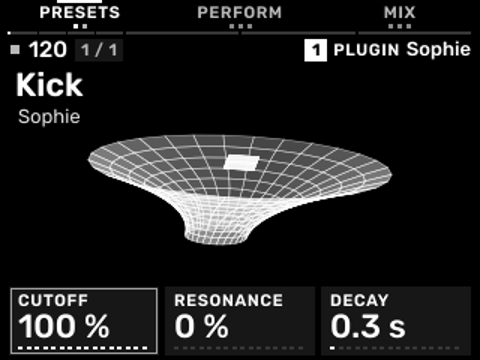

# MPC Sample engine ports

Unofficial native engine adaptations for **Rhythmer OS**, maintained by **jazzy rhythmer**. Original engine names, authors, DSP sources and licenses are retained.

[Download Rhythmer OS](https://github.com/JazzyRhythmer/mpc-sample-rhythmer-os/releases) · [Website](https://jazzyrhythmer.github.io/mpc-sample/) · [Instagram](https://www.instagram.com/jazzyrhythmer/) · [YouTube](https://www.youtube.com/@jazzyrhythmer)

This repository contains port adapters, parameter contracts, pinned original FM-1/Move sources, build helpers and credits. The OS repository contains the sampler, single-sound and Rhythmer Kit host, UI, GEN, Acid and Break workflows, installation and recovery instructions. Melodee by Kerem Kiliç (Ellic Studio) supplies the OS foundation; Open MPC supplies the existing wrapper foundation. These are unofficial ports, not endorsements by the original authors.

## Current release

For RHYTHMER OS **0.4.0-beta.3**: native PRESETS/EDIT integration, source-ordered sound controls and units, focused-pad editing, original Plaits FM programs, and preset/state fixes. The original creators retain authorship of the instruments and DSP; my work is the MPC Sample porting, optimization and host integration.

## Ports and original sources

| Port directory | Original project | Source record |
|---|---|---|
| [drumx](ports/drumx) | [https://github.com/juanjiant-bit/JIANT](https://github.com/juanjiant-bit/JIANT) | [pinned provenance](ports/drumx/SOURCE.json) |
| [fm1-cs1](ports/fm1-cs1) | [https://github.com/twochannels/CS-1.git](https://github.com/twochannels/CS-1.git) | [pinned provenance](ports/fm1-cs1/SOURCE.json) |
| [fm1-elixir](ports/fm1-elixir) | [https://github.com/dmajka/elixir.git](https://github.com/dmajka/elixir.git) | [pinned provenance](ports/fm1-elixir/SOURCE.json) |
| [fm1-fm106](ports/fm1-fm106) | [https://github.com/PatttF/fm-106.git](https://github.com/PatttF/fm-106.git) | [pinned provenance](ports/fm1-fm106/SOURCE.json) |
| [fm1-fmini](ports/fm1-fmini) | [https://github.com/ruppert/fmini-1.git](https://github.com/ruppert/fmini-1.git) | [pinned provenance](ports/fm1-fmini/SOURCE.json) |
| [fm1-guru600](ports/fm1-guru600) | [https://github.com/MarcGoudy/guru-600.git](https://github.com/MarcGoudy/guru-600.git) | [pinned provenance](ports/fm1-guru600/SOURCE.json) |
| [fm1-hortator](ports/fm1-hortator) | [https://github.com/deadactive/hortator.git](https://github.com/deadactive/hortator.git) | [pinned provenance](ports/fm1-hortator/SOURCE.json) |
| [fm1-kwasub](ports/fm1-kwasub) | [https://github.com/Guizmoh/K-WASUB_Firmware_for_FM1.git](https://github.com/Guizmoh/K-WASUB_Firmware_for_FM1.git) | [pinned provenance](ports/fm1-kwasub/SOURCE.json) |
| [fm1-kwasub-kit](ports/fm1-kwasub-kit) | [https://github.com/Guizmoh/K-WASUB_Firmware_for_FM1.git](https://github.com/Guizmoh/K-WASUB_Firmware_for_FM1.git) | [pinned provenance](ports/fm1-kwasub-kit/SOURCE.json) |
| [fm1-mono2k](ports/fm1-mono2k) | [https://github.com/InigoHernandez/mono2k.git](https://github.com/InigoHernandez/mono2k.git) | [pinned provenance](ports/fm1-mono2k/SOURCE.json) |
| [fm1-obervave](ports/fm1-obervave) | [https://github.com/zvenson/obervave.git](https://github.com/zvenson/obervave.git) | [pinned provenance](ports/fm1-obervave/SOURCE.json) |
| [fm1-prophet](ports/fm1-prophet) | [https://github.com/keremimo/melodee.git](https://github.com/keremimo/melodee.git) | [pinned provenance](ports/fm1-prophet/SOURCE.json) |
| [fm1-s1vave](ports/fm1-s1vave) | [https://github.com/AndrewGG88/S1Vave.git](https://github.com/AndrewGG88/S1Vave.git) | [pinned provenance](ports/fm1-s1vave/SOURCE.json) |
| [move-aphex](ports/move-aphex) | [filliformes/aphex-move](https://github.com/filliformes/aphex-move) | [pinned provenance](ports/move-aphex/SOURCE.json) |
| [move-braids](ports/move-braids) | [charlesvestal/schwung-braids](https://github.com/charlesvestal/schwung-braids) | [pinned provenance](ports/move-braids/SOURCE.json) |
| [move-dexed](ports/move-dexed) | [charlesvestal/schwung-dx7](https://github.com/charlesvestal/schwung-dx7) | [pinned provenance](ports/move-dexed/SOURCE.json) |
| [move-hera](ports/move-hera) | [charlesvestal/schwung-hera](https://github.com/charlesvestal/schwung-hera) | [pinned provenance](ports/move-hera/SOURCE.json) |
| [move-plaits](ports/move-plaits) | [j3threejay/move-anything-plaits](https://github.com/j3threejay/move-anything-plaits) | [pinned provenance](ports/move-plaits/SOURCE.json) |

Sophie is included under `ports/sophie`, with the original DSP and notices. The seven classic drum variants remain kit-only in the OS. Elixir is the canonical LXR-family adaptation. Acid uses Hortator; Break and Rhythmer Kit are host features, not separate original synth ports. Original baseline MPC drum packages retain their names and source records in `third_party/mpc-original`.

## Build

See [BUILD.md](BUILD.md) for Linux ARM64 build examples and the distinction between wrappers and native Move DSP modules. The complete engine source is included, with transitive notices under each original tree. The matching OS release provides SOURCE, MOVE-SOURCE and SUPPORT-SOURCE archives for corresponding source and support-library rebuilds.

## Banks and sound design

Original available banks are preserved except the external Sequential Prophet and Erica/Hrtl Elixir banks, whose redistribution permission was not established for this port. They are excluded from both source and binary releases. Native Prophet retains Init; native Elixir retains Initkit. Rhythmer's host-side catalogue adds 15 independently authored Prophet sounds and four seven-voice Elixir kits. These extra choices require the Rhythmer host integration; they are not claimed to be original factory programs or built into a generic standalone wrapper. The four authored Elixir kicks include the approved stronger body/attack.

[Preset provenance and names](docs/RHYTHMER_PRESETS.md) · [Bank audit](docs/ORIGINAL_PRESET_AUDIT_KO.md) · [Source lineage](docs/FM1_LINEAGE_KO.md) · [Credits](THIRD_PARTY_NOTICES.md) · [Validation and limits](docs/VERIFICATION.md)

Licenses apply per component; the root license does not relicense original sources, patches, fonts or third-party assets. This is unofficial software, unaffiliated with AKAI Professional or inMusic, provided without warranty under its applicable licenses. Offline host checks are complete for this beta; physical MPC Sample validation remains pending. Use the OS full SD download for installation; this source repository is not an installer.

## Stay in touch

RHYTHMER OS is free and open source, and will always be free. Your support helps me keep working on this project and other open-source tools.

[Support on Ko-fi](https://ko-fi.com/jazzyrhythmer) · [Patreon](https://www.patreon.com/JazzyRhythmer/) · [Email updates](https://jazzy-rhythmer.kit.com/6dd4006c7c) · [Main website](https://jazzyrhythmer.github.io/) · [Instagram](https://www.instagram.com/jazzyrhythmer/) · [YouTube](https://www.youtube.com/@jazzyrhythmer)
